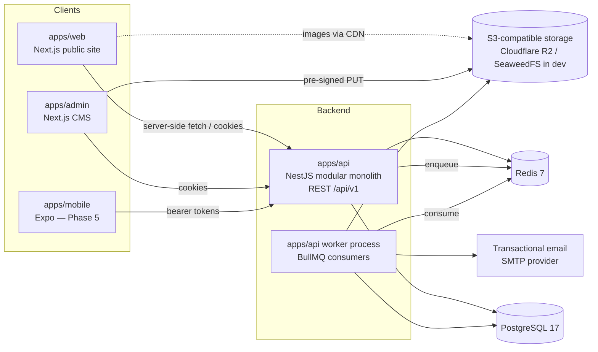
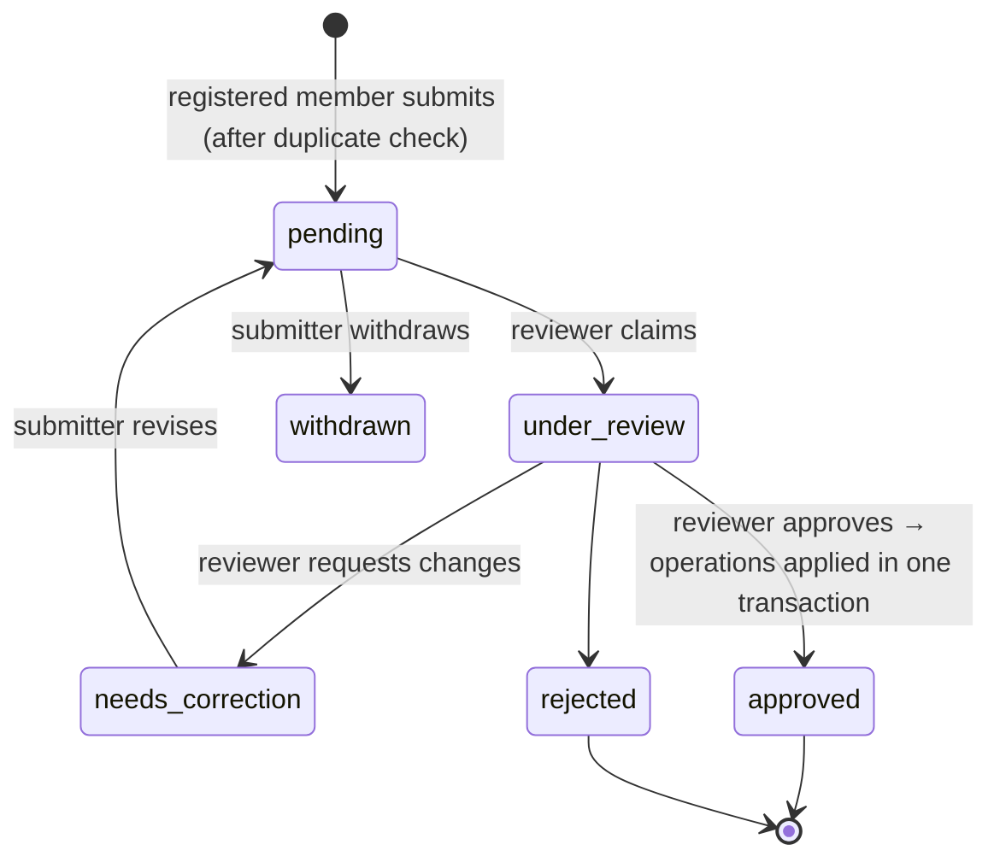

# System Design

Status: **Draft for review** (Phase 0) · Last updated: 2026-11-07

Companion documents: [architecture-decisions.md](architecture-decisions.md) (the *why* of each choice), [../database/schema-design.md](../database/schema-design.md), [../api/api-conventions.md](../api/api-conventions.md).

---

## 1. Overview



- **One backend, one database.** All clients use the same versioned REST API. No client has its own business logic or data store.
- **Modular monolith.** `apps/api` is a single deployable with strict internal module boundaries. The same codebase starts in two modes: `http` (API server) and `worker` (BullMQ job consumers), so heavy work never blocks request handling.
- **Object storage for binaries.** Postgres holds only metadata and storage keys.

## 2. Repository layout (monorepo)

pnpm workspaces + Turborepo (ADR-002).

```text
sambahamphe-community/
├── apps/
│   ├── api/                 # NestJS: HTTP server + worker entrypoints
│   │   ├── src/
│   │   │   ├── main.ts            # http mode
│   │   │   ├── worker.ts          # worker mode
│   │   │   ├── core/              # config, database connection, auth guards, errors, logging, audit
│   │   │   └── modules/<domain>/  # see §3
│   │   ├── src/database/          # Drizzle: schema/<table>.schema.ts, migrations (drizzle/), seeds
│   │   └── test/                  # integration + API tests (Testcontainers)
│   ├── web/                 # Next.js App Router public site
│   ├── admin/               # Next.js CMS (client-heavy, no SEO)
│   └── mobile/              # Expo (Phase 5)
├── packages/
│   ├── contracts/           # @repo/contracts — Zod schemas = request/response contracts + shared enums/types
│   ├── api-client/          # @repo/api-client — typed fetch client generated from OpenAPI
│   ├── ui/                  # @repo/ui — shared React components (Tailwind + Radix primitives)
│   ├── dates/               # @repo/dates — fuzzy date + Bikram Sambat ↔ AD conversion (pure TS, heavily tested)
│   └── config/              # @repo/config — tsconfig, eslint, prettier presets (Bitsky settings, ADR-025)
├── infrastructure/
│   ├── docker/              # Dockerfiles
│   └── deployment/          # compose.prod.yml, Caddy config, backup scripts, runbooks
├── docs/
├── docker-compose.yml       # dev: postgres, redis, minio, mailpit
├── turbo.json
├── pnpm-workspace.yaml
└── package.json
```

Changes from the suggested structure, and why:

- `shared-types` + `validation` merged into **`contracts`**: with Zod the schema *is* the type (`z.infer`), so splitting them creates two packages that always change together.
- `utilities` dropped: generic util packages become dumping grounds. Specific, cohesive packages (`dates`) are created when there is real shared logic.
- `dates` added: BS/AD conversion and fuzzy dates are used by API, web, admin and mobile and must behave identically everywhere.

**Dependency rule:** `apps/*` may depend on `packages/*`; packages never depend on apps; `contracts` depends only on `zod` and `dates`. `api` never imports from `web`/`admin`.

## 3. Backend modules

Modules are grouped into bounded contexts. A module owns its tables; other modules access its data **only through its exported service**, never by querying its tables directly. (Enforced by an ESLint `no-restricted-imports` rule on `modules/*/internal/**`.)

| Context | Module | Owns | Notes |
|---|---|---|---|
| **Identity & Access** | `auth` | sessions, one-time tokens (verification, password reset) | Login, logout, session list, email verification |
| | `users` | users, user_person_links | Account profile; identity claims linking an account to a Person (ADR-022) |
| | `access` | roles, permissions, role assignments | Policy evaluation incl. scopes |
| **People & Genealogy** | `people` | persons, person names, consents, person ⇄ media | The shared **Person** — used by genealogy, boards, articles, photo tags |
| | `genealogy` | parent_child, unions, union_partners, branches, branch membership, sources, citations | Tree queries, cycle checks, kinship paths |
| | `contributions` | change_requests, change_request_items, review comments | Submission/approval workflow (genealogy first, reusable) |
| **Places** | `places` | places (hierarchical, historical names) | Shared by people, events, media, org units |
| **Governance** | `organization` | org unit types, org units, terms, position definitions, appointments | Boards & committees |
| **Publishing** | `content` | content items, translations, revisions, categories, tags | Articles, heritage, blog, announcements, pages |
| | `events` | events, event categories, event ⇄ org units | |
| **Media** | `media` | media assets, variants, galleries, gallery items, media tags | Upload pipeline, processing jobs |
| **Platform** | `audit` | audit_log | Append-only, written by an interceptor + explicit domain events |
| | `notifications` | notification outbox, email templates | Email via worker |
| | `search` | (no tables; uses FTS indexes owned by modules) | Aggregated search endpoint |

Inside each module:

```text
modules/genealogy/
├── genealogy.module.ts
├── http/                  # controllers: thin — parse, authorize, delegate, map response
├── application/           # services / use-cases: transactions, orchestration, policies
├── domain/                # pure logic: cycle rules, kinship computation, privacy redaction
└── internal/              # repositories, raw SQL, mappers (private to module)
```

Controllers contain no business logic (brief §11.14). Domain logic that has no I/O lives in `domain/` and is unit-tested without a database. Layering is deliberately shallow: no generic repository base class, no CQRS framework.

## 4. Cross-cutting concerns

### 4.1 Authentication

- Email **or** mobile number + password (argon2id); at least one identifier must be verified (email link or SMS code, ADR-024) before contributing. SMS sending goes through a provider interface, run by the worker.
- **Server-side sessions** (ADR-006): login creates an `auth_sessions` row and returns a random 256-bit token; only its SHA-256 hash is stored. Each request looks it up; revoking a session takes effect on the next request.
- **Same-origin API:** in production Caddy serves the API under each frontend's origin (`sambahamphe.org.np/api/v1/…`, `admin.sambahamphe.org.np/api/v1/…`); locally the Next.js apps proxy `/api` to `localhost:3001`. Cookies are therefore host-only: the public `sid` and admin `admin_sid` can never mix, the Next.js server receives the cookie during SSR, and no CORS is needed for the browser apps.
- **Web/admin:** the token in an `HttpOnly; Secure; SameSite=Lax` cookie. CSRF: unsafe methods require an allow-listed `Origin` header and a JSON body.
- **Mobile:** same endpoints with `X-Client: mobile`; the token is returned in the body, kept in Expo SecureStore and sent as `Authorization: Bearer`.
- **Lifetimes:** member sessions slide for 30 days (the expiry is extended at most once a minute to avoid a write per request); admin sessions end after 2 h idle or 12 h absolute.
- Rate limiting per client IP on login, registration, verification and reset (`@nestjs/throttler`, 10/min; 300/min default). Counters are **in memory**, correct for our single API instance; several instances would need shared Redis storage (the Redis storage adapter did not yet support NestJS 12 in Nov 2026). Per-account lockout backoff is a later addition.

### 4.2 Authorization

Three separate concepts (ADR-013):

1. **Organizational position** — governance fact (e.g., "Regional Secretary, Koshi Region, 2080–2083 BS"). No permissions.
2. **Role** — named bundle of permissions (`genealogy_editor`, `content_editor`, …), configurable in DB.
3. **Role assignment** — user × role × optional **scope** (`global`, `org_unit:<id>`, `branch:<id>`). A scope on an org unit includes all its descendants.

Permissions are strings `resource:action` (e.g., `person:update`, `appointment:create`, `change_request:review`). A NestJS guard checks the required permission; for scoped resources, the service supplies the resource's scope path (e.g., the org unit's ancestors) and the policy checks for any assignment covering it.

Record-level privacy (who may see a living person's birth date) is **not** RBAC. It is handled by the people module's `PrivacyPolicy` (§5.4), which uses the viewer's approved **branch access** (ADR-021) and individual grants.

Mapping to the [genealogy access policy](../product/genealogy-access-policy.md) levels:

| Policy level | Mechanism |
|---|---|
| 1 Public visitor | No session; privacy policy shows `public` fields only |
| 2 Registered member | Active user with verified email; may create change requests and branch-access requests |
| 3 Verified family member | Approved `branch_access` rows; privacy policy shows `branch` fields for persons in those branches |
| 4 Genealogy editor | `genealogy_editor` role (global or branch-scoped) |
| 5 Super administrator | `super_admin` role |

### 4.3 Validation & contracts

- Zod schemas in `packages/contracts` define every request and response body.
- The API validates with a global Zod pipe and serializes responses through the response schema (strips unknown fields — prevents accidental leaks of private columns).
- OpenAPI 3.1 is generated from the Zod schemas at build time (`docs/api/openapi.json`), and `packages/api-client` is generated from that. Clients never import backend code.

### 4.4 Errors, logging, observability

- Errors: RFC 9457 `application/problem+json` (see API conventions).
- Structured JSON logs (pino) with request ID; PII-free by policy (no names/dates of birth in logs).
- Health endpoints `/health/live`, `/health/ready`. Error tracking via Sentry-compatible SDK (self-hostable GlitchTip is an option for cost).

### 4.5 Auditing & history

Two complementary mechanisms:

- **`audit_log`** — named domain events (`auth.login_failed`, `role.assigned`, later `person.updated`…): actor, action, entity, a small `changes` object with ids/keys only, request ID, IP hash. Written by services **inside the transaction of the change** (`AuditService.record(event, tx)`); request details come from a per-request context (`AsyncLocalStorage`). A generic "log every write request" interceptor was considered and dropped: its entries only say "`POST /x` happened", which the request log already shows. **Append-only is enforced by a database trigger** that rejects `UPDATE`, `DELETE` and `TRUNCATE`, so it holds even for scripts and console sessions. Answers "who did what, when".
- **Entity revisions** — for genealogy records and content: full snapshots per version, used for diff, restore and the change-request base-version check. Answers "what did this record look like at version n".

### 4.6 Background jobs (BullMQ)

| Queue | Jobs |
|---|---|
| `media` | generate image variants (sharp → AVIF/WebP, 4 widths), strip EXIF GPS, extract dimensions/duration, compute checksum, PDF thumbnail |
| `email` | verification, password reset, review notifications, digest |
| `exports` | GEDCOM / CSV / full-archive export, large reports |
| `imports` | genealogy CSV/GEDCOM import (staged into change requests) |
| `maintenance` | expire announcements, purge expired sessions, refresh search materializations |

Jobs are idempotent and retried with exponential backoff. Domain writes that must trigger jobs use a **transactional outbox** table so a job is never enqueued for a transaction that rolled back. The worker polls it every second (`FOR UPDATE SKIP LOCKED`), adds each row to BullMQ with the row id as job id (duplicates are ignored), then deletes the row. Payloads can contain one-time links, so nothing is kept after hand-off, and finished jobs are removed from Redis.

### 4.7 Internationalization

- UI strings: `next-intl` in web/admin, locale-prefixed routes (`/en/...`, `/ne/...`).
- Content: per-locale translation rows (ADR-015). Person names: multiple names per person with `script` and `language`.
- Dates: shown in BS and AD; stored per ADR-011.
- Fonts: a font stack covering Latin, Devanagari and Limbu (e.g., Noto Sans / Noto Sans Devanagari / Noto Sans Limbu), self-hosted subsets.

## 5. Domain design highlights

### 5.1 Person is shared

A single `persons` table serves genealogy, board appointments, article subjects and photo tags. A board member is a Person who may or may not have genealogy relationships. This avoids duplicated identities (one real person appearing as a "board member" record and a separate "family tree" record). The cost is that privacy rules must be context-aware: a living person's *board role* is public, their *birth date* is not.

### 5.2 Genealogy: a male-line tree stored in a general model

The genealogy records the **Sambahamphe male line** (ADR-020). Every lineage member has exactly one accepted father, so the lineage forms a **true tree**: one person's ancestors are a single chain of fathers, and descendants branch downward. Wives (`spouse`) are attached to their husbands through unions, and appear as mothers of lineage children. Their own ancestry is not recorded. A daughter's record ends with her (no marriage or children recorded). Adopted sons continue the line, and several founding ancestors head the top-level branches.

We still store `parent_child` edges plus `unions` (partner sets), and query them with **recursive CTEs** bounded by depth (ADR-004), instead of a bare `father_id` column. The general model handles disputed fathers, adoption, multiple marriages and half-siblings. It also leaves the scope open to widening later without a migration.

Core queries (all depth-bounded, privacy-filtered):

| Query | Method |
|---|---|
| Family unit of X (parents, unions + partners, children, siblings) | Simple joins |
| Ancestors of X to depth n | Recursive CTE up `parent_child` |
| Descendants of X to depth n | Recursive CTE down |
| Relationship path / common ancestors of X and Y | Two ancestor CTEs, intersect, pick minimal generational distance; fall back to bidirectional BFS over all edges for in-law paths |
| Cycle check before inserting parent P → child C | `C` must not be in ancestors(P) — checked inside the insert transaction under an advisory lock on the genealogy graph |

If profiling at scale ever shows CTEs too slow, a maintained **closure table** (`ancestor_id, descendant_id, depth`) can be added without changing the API.

### 5.3 Change requests (contribution workflow)

All genealogy writes — including editors' direct edits — flow through one path:



- A change request contains ordered **operations** (`create_person`, `update_person`, `add_parent_child`, `add_union`, `set_relationship_status`, `merge_persons`, …), each a Zod-validated payload. New entities are referenced by temporary client IDs within a request, so "add my grandfather and link him to my father" is one atomic request.
- Each update operation records the **base version** of the record it edits. On approval, if the record has moved on, the operation is marked *conflicting* and the reviewer must rebase or resolve; nothing is silently overwritten.
- **Identity claims** (ADR-022) are a separate, lighter queue: a claim links an account to a person record and, by default, grants access to that person's branch. A narrow, rate-limited **claim lookup** (name + father's name + birth year → at most 3 masked matches) lets claimants find their own record, even though living people are otherwise hidden from them.
- **"My Family Tree → Add Family Member"** (needs an approved identity link) turns a relationship choice into operations. *Son/Daughter* → `create_person` + `add_parent_child` from the member's own record. *Father/Mother* → a parent edge to the member's record. *Spouse* → `add_union` (lineage men only). *Sibling* → a child of the member's father. The male-line rules (ADR-020) reject impossible choices up front, e.g. children under a daughter.
- Any registered member with a verified email or phone can submit (rate-limited). Before submission, the form searches for the person, the member picks an existing relative as anchor, and the **duplicate check** shows likely matches (schema-design §16).
- Editors with `genealogy:write_direct` create change requests that are auto-approved on submission — same audit trail, same versioning, no separate code path.
- Relationship removals are expressed as status changes (`rejected`/`retracted`) with a reason, not deletes.

The workflow lives in `contributions` and is generic enough to reuse for member-submitted articles and photos in Phase 4.

### 5.4 Privacy policy

Implemented as pure domain functions in `people/domain/privacy.ts`, applied in the service layer before data reaches a response schema.

- **Living status:** explicit `is_living` (true/false/unknown). Unknown is treated as living if there is no death date and birth is within 110 years or unknown — i.e., deny-by-default. Editors set `deceased` explicitly for historical people without dates (imports do this in bulk). Inferring status from relatives' dates is a possible later refinement.
- **Visibility levels** (ordered): `public` < `members` (used for content and media only) < `branch` (viewers with approved access to one of the person's branches) < `restricted` (named per-person grants) < `private` (genealogy editors only).
- Each person has a **record visibility** and optional **field-group overrides** for: `names`, `vital_dates`, `places`, `biography`, `photos`, `contact`, `relationships`.
- **Defaults on approval:** deceased → `public`. Living → names and relationships visible at `branch`; dates, places, biography and photos at `restricted`; contact `private` (full table in schema-design §4). Public exposure of a living person requires a consent record (who consented, for whom, scope, date, evidence). A submitter's input never counts as consent for someone else.
- **Minors** (ADR-023): names and relationships at `branch`, all else `private`, no photos, never `public` before 18. They can only be added by a linked parent/guardian or an editor.
- **Redaction in the tree:** for public visitors and registered members without access, living people are **pruned** (not shown as placeholders), together with anything reachable only through them. For a verified family member, living people outside their branches are pruned the same way.
- **Every outlet** — tree, profile, search, sitemaps, JSON-LD, the public API and **exports** (GEDCOM/CSV) — goes through the same policy function. Tests for the policy are table-driven and mandatory.

### 5.5 Organizational governance

```text
PositionDefinition (Chairperson, Secretary…) — one list, the same on every board
OrgUnitType (configurable)
     │ allowed parent types
     ▼
OrgUnit (tree: Central Board → Regional Boards → Gaau Committees)
     │
     ├── Term (2079-01-15 BS → 2082-..)  ◀── elected at Event (General Assembly)
     │
     └── Appointment: Person × OrgUnit × Position × Term? × [start, end) × type × end_reason
```

- Appointments carry their own dates because people resign, are co-opted or serve as acting holders mid-term. A term gives the default dates.
- "Current board" = appointments whose date range contains today. "Board for term T" = appointments linked to T.
- Exclusive positions (max one holder) are protected by a Postgres **exclusion constraint** on overlapping date ranges (see schema design).

### 5.6 Event status

`lifecycle_status` is **computed** from `starts_at`/`ends_at` and an optional stored override (`cancelled`, `postponed`). Storing "upcoming/ongoing/completed" would go stale without a cron job and could contradict the dates. Publication status (`draft/published/archived`) is a separate column.

### 5.7 Media pipeline

1. Admin client requests an upload: `POST /media/uploads` with filename, MIME, size → API validates type/size, creates `media_assets` row (`status=uploading`), returns a pre-signed PUT URL (5 min) to `originals/<uuid>`.
2. Client uploads directly to object storage.
3. Client calls `POST /media/{id}/complete` → API verifies object exists & size matches, enqueues `media.process`.
4. Worker sniffs real MIME (magic bytes), rejects mismatches, strips GPS EXIF from derivatives, generates variants, sets `status=ready`.
5. Public delivery via CDN from the `public/` prefix only; restricted media served through short-lived signed GET URLs from the API.

Originals are never modified (archival). Derivatives can be regenerated.

### 5.8 Search

Postgres full-text search (`tsvector` with `simple` config — no stemming dictionary exists for Nepali/Limbu) plus `pg_trgm` for fuzzy name matching and `unaccent` for romanized names. A romanization column stores a normalized Latin transliteration of Devanagari names to allow "Sambahamphe" ≈ "सम्बाहाम्फे" ≈ "Sambahangphe" style matching. A dedicated engine (Meilisearch) is a later option only if needed.

## 6. Frontend architecture

### 6.1 Public website (`apps/web`)

- Next.js 16 App Router, React Server Components, Tailwind v4, `next-intl` (`/en`, `/ne`; `src/proxy.ts` redirects `/` by browser language). `/api/*` is forwarded to the API (Caddy in production, a Next rewrite locally), so the session cookie is same-origin. Forms use TanStack Form with the `@repo/contracts` rules and translated messages; client data via TanStack Query and `@repo/api-client`.
- **Caching:** content pages statically generated with on-demand revalidation (API sends a signed revalidate webhook on publish). Genealogy pages are dynamic and viewer-dependent (privacy), so not cached publicly when a session exists.
- SEO: metadata API, `sitemap.xml` per locale, JSON-LD (`Article`, `Event`, `Person` for public deceased records, `Organization`).
- Family tree page: client component using **React Flow (@xyflow/react)**. Because the lineage is a true tree (ADR-020), the main view is a classic **top-down descendant tree** (vamshawali style) laid out with `d3-hierarchy`, with wives shown beside their husbands. A "my lineage" view shows the single father-chain from a person up to the founding ancestor. Branch navigation jumps to a branch founder. Each expand fetches a bounded neighborhood (`/genealogy/persons/{id}/tree?up=2&down=2`). Virtualized rendering is built into React Flow. Mobile: pan/zoom gestures, a list-based "family card" fallback view for small screens and screen readers.

### 6.2 Admin CMS (`apps/admin`)

- React + Vite single-page app (ADR-007): TanStack Router (file-based, a signed-in gate on every page), TanStack Query for server state, TanStack Form, `use-intl` messages (en/ne). Vite's dev proxy forwards `/api` with `X-Client: admin`; Caddy does the same in production.
- Rich-text editor: **Tiptap** (ProseMirror), content stored as JSON (ADR-009).
- Genealogy editor: profile forms plus a relationship editor that lets editors add parents/partners/children from the tree, and a review inbox with side-by-side diff of proposed vs current values.

### 6.3 Shared UI (`packages/ui`)

Accessible primitives (Radix) styled with Tailwind tokens. Visual identity: warm, earthy palette drawn from Limbu textiles (to be refined with the organization's branding), serif display type for heritage storytelling, generous whitespace; not a generic dashboard look on the public site.

### 6.4 Mobile (`apps/mobile`, Phase 5)

Expo + Expo Router, the same `api-client` and `contracts`, bearer-token auth. Read-focused at first (news, events, tree browsing, profile); contributions later. Push notifications via Expo push service from the notifications worker.

## 7. Infrastructure & environments

| Environment | Setup |
|---|---|
| **Local dev** | `pnpm infra:up`: Postgres 17, Redis 7.4, SeaweedFS (S3), Mailpit. Apps run via `pnpm dev` (Turborepo). |
| **CI** | GitHub Actions: install (pnpm cache) → lint → typecheck → unit tests → integration tests (Testcontainers Postgres/Redis) → build → Playwright e2e against compose stack. |
| **Staging / Production** | Recommended starting point (low cost, simple): one VPS (4 vCPU / 8 GB) running Docker Compose with Caddy (TLS), `api`, `worker`, `web`, `admin`, Redis. **Managed Postgres** (or self-hosted with WAL-G continuous backup to object storage). **Cloudflare R2** for media (no egress fees) behind Cloudflare CDN. |

Backups: nightly logical dump + continuous WAL archive; 30-day retention; quarterly restore drill documented in `infrastructure/deployment/runbooks/`. Media bucket versioning on. A yearly "archive export" (JSON + media manifest + GEDCOM) stored offline by the organization.

Configuration: environment variables validated at startup with a Zod schema (process exits on invalid config). Secrets never committed; `.env.example` documented.

The design runs equally on a PaaS (Render/Fly/Railway) if the organization prefers not to operate a VPS — Recommended plan and costs: [../operations/hosting-and-costs.md](../operations/hosting-and-costs.md) (DigitalOcean Bangalore, ≈ $31/month).

## 8. Security checklist (baseline)

- Argon2id, rate limiting, lockout backoff, session revocation, reuse detection.
- Strict Zod validation on input; response schemas on output (no field leaks).
- Parameterized SQL only (Drizzle query builder or its `sql` template); no string-built SQL.
- Upload: MIME allow-list, size limits, magic-byte verification, no SVG upload (XSS), served from separate cookie-less domain.
- Rich text: Tiptap JSON rendered via an allow-listed renderer; HTML sanitized if ever accepted.
- Security headers via Caddy/Next (CSP, HSTS, frame-ancestors none, Referrer-Policy).
- CORS allow-list per environment.
- Least-privilege DB roles: `app_rw` (no DDL, no UPDATE/DELETE on `audit_log`), `migrator` (DDL).
- Dependency scanning (Renovate + `pnpm audit` in CI).
- PII minimization in logs; IPs stored hashed in audit log.

## 9. Key risks

| Risk | Mitigation |
|---|---|
| Privacy breach of living people's data | Single privacy policy function, deny-by-default, response schemas, table-driven tests, review of every public endpoint |
| Data corruption in genealogy (wrong merges, cycles) | Change requests, versions, cycle check, merge as reversible operation with redirect |
| Single maintainer / bus factor | Mainstream stack, docs, runbooks, conventional code, CI gates |
| Volunteer data entry quality | Structured forms, duplicate detection, reviewer workflow, source citations |
| Cost creep | Single VPS, R2, no paid SaaS dependencies required |
| BS↔AD conversion errors | Isolated `packages/dates` with exhaustive table-based tests; original value always stored |
| Scope creep before core is solid | Phased roadmap with exit criteria |
