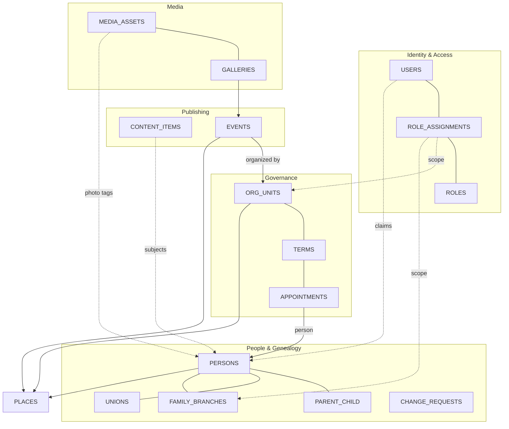
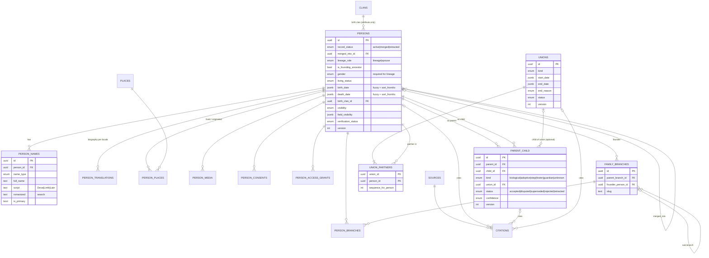
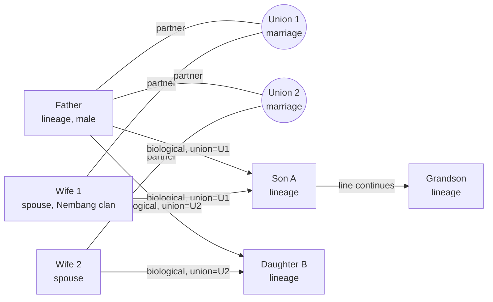
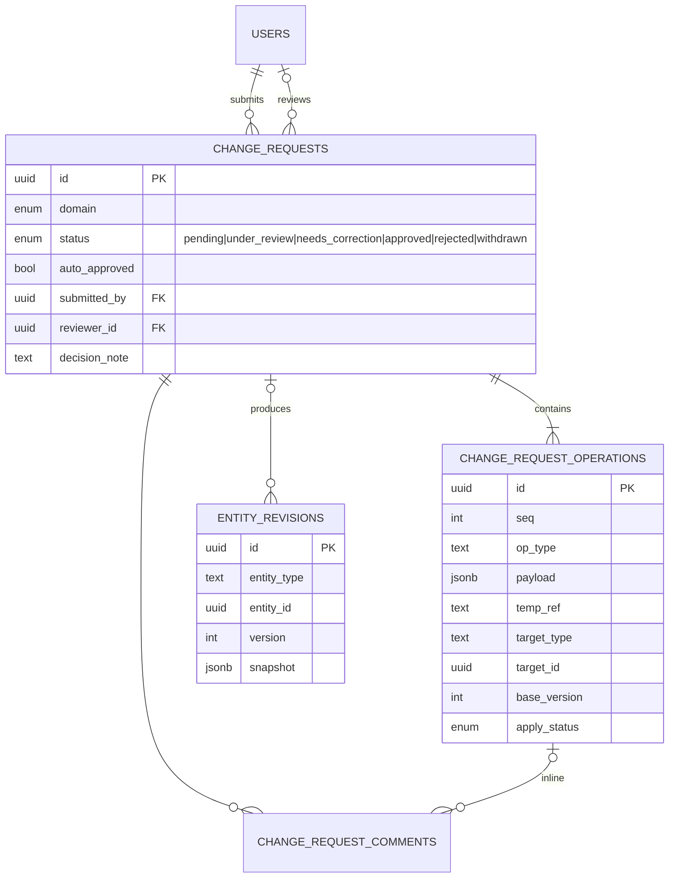
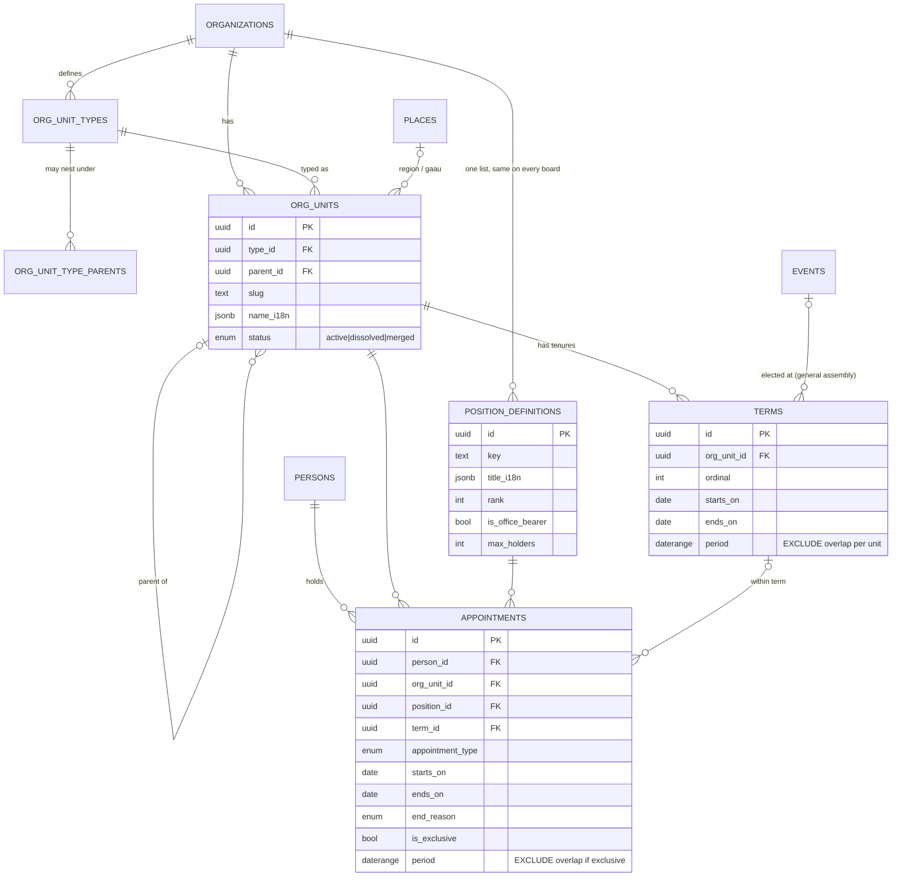
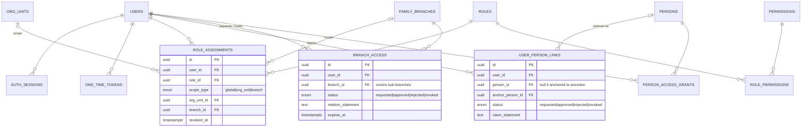
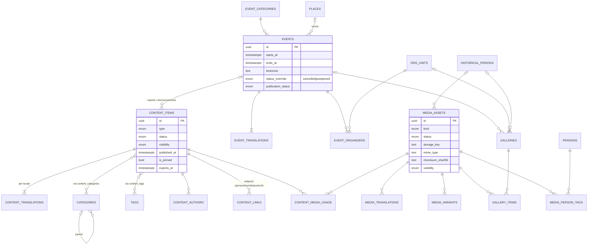

# Entity-Relationship Diagrams

Status: **Draft for review** (Phase 0). Column-level detail and constraints are in [schema-design.md](schema-design.md); these diagrams show entities and cardinality only. Audit columns (`created_at`, `created_by`, …) are omitted. Split by bounded context — `PERSONS`, `PLACES`, `MEDIA_ASSETS` and `USERS` are shared and appear in several diagrams.

## 1. Context map

## 2. People & genealogy

### 2.1 How a family is represented (male line, ADR-020)

Each parent edge is independent, so a child with an unknown mother simply has one edge. Half-siblings are distinguished by `union_id`. Descent continues only through sons, biological or adopted: Son A can have children recorded. Daughter B's record ends with her; her marriage and children are not recorded. Several founding ancestors head the top-level branches.

## 3. Contributions & revisions

## 4. Organization & governance

## 5. Access control

Note: there is deliberately **no** relationship between `APPOINTMENTS`/`POSITION_DEFINITIONS` and `ROLES` (ADR-013). `BRANCH_ACCESS` and `PERSON_ACCESS_GRANTS` control *which genealogy data a user can see* (privacy); roles control *which actions a user can take* (ADR-021).

## 6. Publishing, events, media

